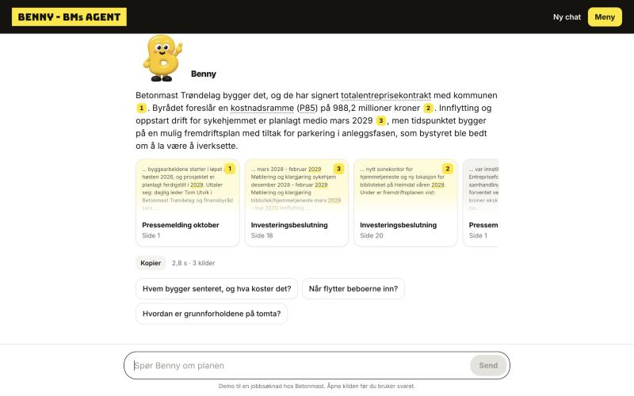
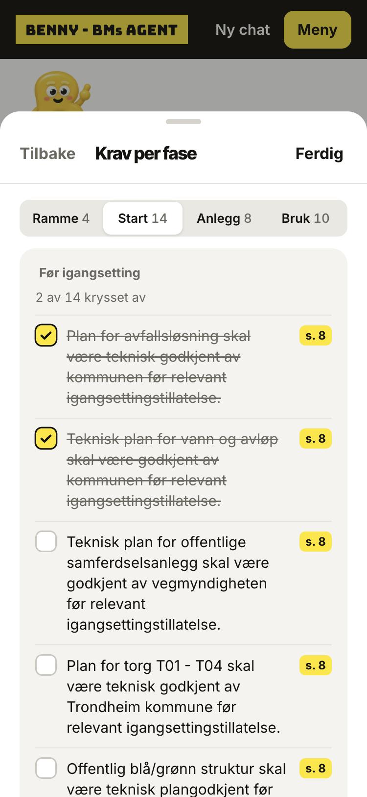
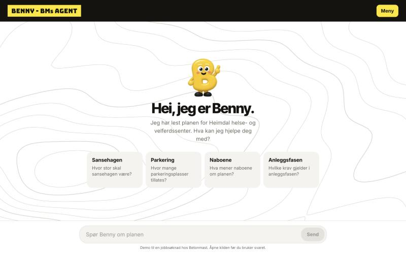
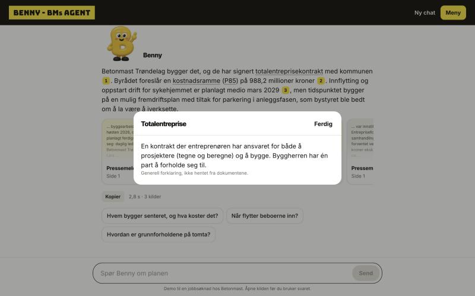
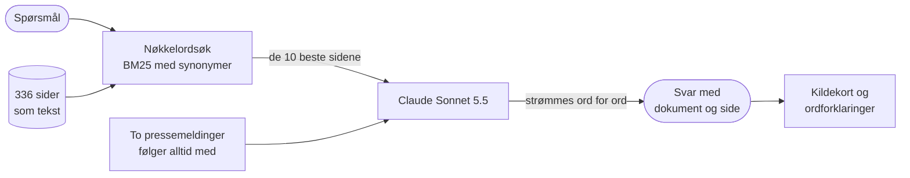

<p align="center">
  
</p>

<h1 align="center">Benny</h1>

<p align="center">
  En agent som har lest de offentlige dokumentene om Heimdalstunet helse- og velferdssenter i Trondheim,<br>
  og som svarer med dokument og sidetall.
</p>

<p align="center">
  <a href="https://benny.schlytterconsult.no"><b>benny.schlytterconsult.no</b></a> · bak passord · laget som demo til en jobbsøknad hos Betonmast
</p>

<p align="center">
  
</p>

## Hva den gjør

| | |
|---|---|
| **Svar med kilde** | Hver påstand får en nummerert henvisning. Et trykk åpner utdraget og PDF-en på riktig side. |
| **Sier fra når den ikke vet** | Står ikke svaret i dokumentene, svarer Benny «Finner ikke dette i dokumentene.» og gjetter ikke. |
| **Vet hva som er nyest** | Når kildene spriker på kostnad eller fremdrift, sier Benny hvilken som er nyest. |
| **Forklarer fagspråket** | 53 uttrykk og koder (P85, ÅDT, Lden, BYA …) er klikkbare og forklares i vanlig språk. |
| **Krav per fase** | De 36 kravene i planbestemmelsene som sjekkliste, med nedlasting til Excel. |
| **Bygget for mobil** | Ark nedenfra, segmentvelger og trygge soner på iPhone. Fungerer like godt på PC. |

<table>
  <tr>
    <td width="33%" valign="top"></td>
    <td width="67%" valign="top">
      <br><br>
      
    </td>
  </tr>
</table>

## Tallene

| 21 kilder | 336 sider | 12 av 12 | ca. 2 sekunder |
|:---:|:---:|:---:|:---:|
| plansak, fagrapporter, politiske saker og pressemeldinger | lest side for side | riktige i testsettet, med riktig kilde | per svar |

## Slik virker det



Det er ingen database og ingen vektordatabase. Alle sidene ligger som tekst i `data/pages.json`, et nøkkelordsøk
finner de ti beste, og modellen får bare dem. Det holder kostnaden nede og gjør det lett å se hvorfor et svar ble
som det ble. De to siste rundene i samtalen sendes med, slik at oppfølgingsspørsmål som «og hvor mange av dem er i
kjelleren?» blir forstått.

| Del | Fil |
|---|---|
| Chatten | `src/app/Chat.tsx` |
| Søk | `src/lib/search.ts` |
| Prompt og regler | `src/lib/prompt.ts` |
| Kall til Claude, strømming | `src/lib/ask.ts`, `src/app/api/ask/route.ts` |
| Kildene | `src/lib/docs.ts`, `data/pages.json` |
| Ordliste | `src/lib/glossary.ts` |
| Passordsperre | `src/proxy.ts`, `src/app/api/unlock/route.ts` |
| Kostnadsvern | `src/lib/ratelimit.ts` |

## Kildene

| Type | Dokumenter |
|---|---|
| **Plansaken** (vedtatt 19.06.2025) | Planbestemmelser, planbeskrivelse, saksfremlegg, fagnotat, bystyrets vedtak |
| **Fagrapporter** | Støy, geoteknikk, VA-plan, trafikk, kapasitet, brann, ROS-analyse, klimagass |
| **Byggeprosjektet** | Investeringsbeslutningen med bystyrets vedtak 23.09.2026, formannskapssaken fra 2024 med vedtak |
| **Kommunens generelle krav** | Funksjonsprogram for helse- og velferdssentre, miljøkrav i byggeprosjekt |
| **Pressemeldinger** | Betonmast 09.02.2026 og AF Gruppen 21.10.2026, som korte sammendrag med lenke |

Alt er offentlig og hentet fra Trondheim kommune, Betonmast og AF Gruppen. Tegninger, kart, anbudspapirer og
avisartikler er ikke med.

## Det den ikke kan

Benny leser bare tekst, så kart, tegninger og tabeller som er bilder, går tapt. Søket er nøkkelordbasert: spør du
med helt andre ord enn dokumentet bruker, kan riktig side bli oversett. Svarene er ikke fasit. Åpne kilden før du
bruker dem.

## Teknikk

Next.js 16 og TypeScript på Vercel i Frankfurt. Claude Sonnet 5.5 gjennom Claude-API-et, kalt bare fra serveren.
Maks 30 spørsmål per time og 60 per døgn per bruker, og 500 totalt per døgn. Appen lagrer ikke spørsmål eller svar;
loggen har bare antall og svartid. Siden er skjult for søkemotorer.

```bash
npm install
```

```bash
npm run dev
```

Lokalt trengs `.env.local` med `ANTHROPIC_API_KEY` og eventuelt `SITE_PASSWORD`.

## Drift

### Legge til et dokument

1. Legg til en linje i `DOCS` i `src/lib/docs.ts` (nøkkel, tittel, PDF-adresse), og øk `EXPECTED_PAGES` med sidetallet.
2. Kjør `npm run extract`. Skriptet stopper uten å skrive filen hvis sidetallet ikke stemmer.
3. Kjør `npm run eval` og se at scoren holder seg.
4. Kjør `vercel deploy --prod`.


### Kjøre testsettet på nytt

`npm run eval` kjører de 12 spørsmålene i `src/lib/tests.ts` mot samme logikk som nettsiden og skriver
`data/eval-results.json`. Det koster 12 kall. Nettsiden viser filen statisk, så deploy etterpå.
Feiler noe, endre søk (`search.ts`) eller prompt (`prompt.ts`), ikke fasiten.

### Menyen

«Meny» øverst åpner Krav per fase (sjekkliste som huskes i nettleseren, og nedlasting til Excel), Nøkkeltall,
Dokumentene og Om demoen. Nøkkeltallene står i `src/lib/facts.ts`. Kjør `npx tsx scripts/check-facts.ts` etter
endringer: den kontrollerer at hvert tall faktisk står på siden det viser til.

### Krav per fase

`npx tsx --env-file=.env.local scripts/findings.ts` lar modellen lese alle sidene én gang og skriver
`data/findings-raw.json`: krav per fase fra planbestemmelsene (og forslag til avvik mellom dokumentene, som ikke
vises fordi de var for tvetydige). Hvert punkt har
et ordrett sitat som kontrolleres maskinelt mot siden. Gå gjennom filen for hånd, ta ut det som er usikkert, og
lagre resultatet som `data/findings.json`. Nettsiden viser den filen statisk.

### Stresstest

`RATE_PER_HOUR=999 RATE_PER_DAY=999 npx tsx --env-file=.env.local scripts/stress.ts` sender ugyldige forespørsler og
31 vanskelige spørsmål, seks samtidig, mot rutehandleren og flagger svar uten kilde, ukjente kilder, markdown og
avkuttede svar. Det koster rundt 25 kall.

### Miljøvariabler

`ANTHROPIC_API_KEY` er nøkkelen, og den brukes bare på serveren. `ANTHROPIC_MODEL` er `claude-sonnet-5-5` som
standard; sett den til `claude-haiku-5-5` i Vercel og deploy på nytt for å bytte. `DAILY_CAP` er global grense
per døgn (500). `RATE_PER_HOUR` (30) og `RATE_PER_DAY` (60) er grensene per IP. Lokalt ligger de i `.env.local`.

Modellene avviser `temperature`, så den sendes ikke. Tenkingen er slått av i stedet (`src/lib/ask.ts`).

### Kostnadsvern

`npm run test:limits` tester inndatakontroll, timegrense, døgngrense og global grense mot rutehandleren. Det koster ett kall.

Uten Redis telles det i minnet per serverinstans, og telleren nullstilles ved kaldstart. For ekte grenser:
godta vilkårene på https://vercel.com/thomas030505s-projects/~/integrations/accept-terms/upstash og kjør

    vercel integration add upstash/upstash-kv --name heimdal-ratelimit -e production --no-env-pull
    vercel deploy --prod

Koden bruker Redis automatisk når `KV_REST_API_URL` og `KV_REST_API_TOKEN` finnes.

### Passord

Hele siden og `/api/ask` ligger bak ett felles passord. Det står bare i miljøvariabelen `SITE_PASSWORD`
(Vercel og `.env.local`). `src/proxy.ts` sender alle uten gyldig informasjonskapsel til `/logg-inn`, og
`/api/unlock` setter kapselen (en hash av passordet, 30 dager). Maks 10 forsøk per 10 minutter per IP.
Bytt passord med `vercel env rm SITE_PASSWORD production`, `vercel env add SITE_PASSWORD production --sensitive`
og `vercel deploy --prod`; da må alle logge inn på nytt. Uten variabelen er sperren av.

### Domene

schlytterconsult.no har navnetjenerne hos Vercel, så `benny.schlytterconsult.no` og `heimdal.schlytterconsult.no` virker uten egen DNS-post.
Flyttes DNS et annet sted, er posten `CNAME benny cname.vercel-dns.com`.

Siden er skjult for søk med `robots.txt`, meta-taggen `noindex` og headeren `X-Robots-Tag`.

### Ordliste

`src/lib/glossary.ts` har 53 faguttrykk og koder (P85, ÅDT, Lden, BYA, totalentreprise …) med en enkel forklaring.
Uttrykkene understrekes i svarene første gang de dukker opp, og et trykk åpner forklaringen. Hele listen ligger
under Meny → Ordliste. Forklaringene er generelle og skrevet for hånd, ikke hentet fra dokumentene. Nytt ord:
legg til en linje i `GLOSSARY` med et regulært uttrykk i `re` (`cs: true` hvis store bokstaver må stemme).
